# 🛡️ DIO Agent — Especialização em Análise de Vulnerabilidades

Projeto desenvolvido como parte do curso **Santander Cibersegurança**, em parceria com a [DIO](https://www.dio.me/).

O objetivo deste projeto foi evoluir o DIO Agent, criando uma especialização voltada à **Segurança da Informação**, com foco na identificação, análise e mitigação de vulnerabilidades.

A proposta foi transformar o agente em um assistente capaz de atuar como mentor de segurança, compreendendo o contexto antes de apresentar soluções, avaliando riscos e orientando o usuário sobre boas práticas defensivas.

---

## 🎯 Objetivos do projeto

- Identificar vulnerabilidades em aplicações Python.
- Compreender os riscos associados ao SQL Injection.
- Utilizar Inteligência Artificial como apoio à análise de segurança.
- Criar uma Skill especializada em análise de vulnerabilidades.
- Adicionar conhecimentos de Segurança da Informação ao agente.
- Especializar o comportamento do agente por meio de instruções.
- Testar a capacidade do agente de compreender cenários antes de recomendar ações.

---

# 🔍 1. Identificação e correção de SQL Injection

O primeiro passo foi desenvolver uma aplicação em Python, chamada `app.py`, utilizando SQLite para simular um sistema de autenticação.

Inicialmente, o código apresentava uma vulnerabilidade de **SQL Injection**, causada pela concatenação direta dos dados fornecidos pelo usuário na consulta SQL.

Essa falha pode permitir que entradas manipuladas alterem a lógica da consulta ao banco de dados, comprometendo a segurança da aplicação.

### 1.1. Código vulnerável

Foi desenvolvido um código de autenticação que utiliza diretamente os dados informados pelo usuário na construção da consulta SQL.

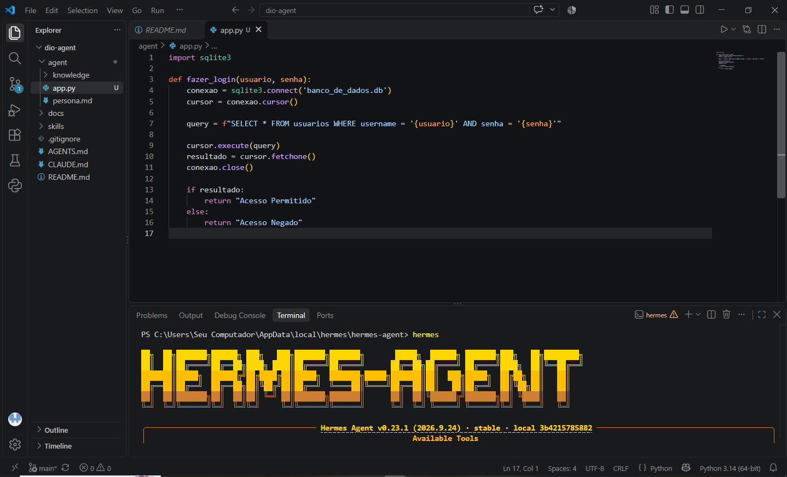

### 1.2. Análise utilizando o Hermes

Para identificar a vulnerabilidade, utilizei o agente de Inteligência Artificial Hermes, solicitando uma análise com foco em AppSec (Application Security).

**Comando utilizado:**

> Atue como um Especialista em AppSec. Leia o arquivo app.py nesta pasta. Identifique se existe alguma vulnerabilidade como um atacante poderia explorá-la, cite a técnica correspondente no MITRE ATT&CK e reescreva o código corrigindo a falha de forma segura.

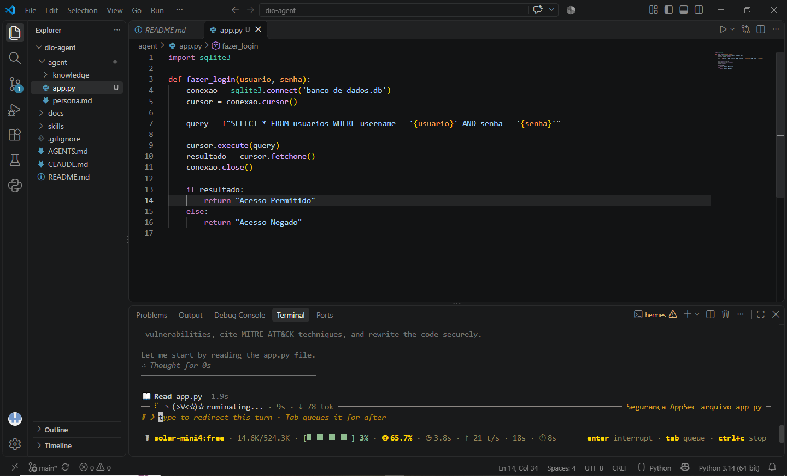

### 1.3. Resultado da análise

O Hermes realizou a análise do código e apresentou uma explicação sobre a vulnerabilidade identificada, seus riscos e a necessidade de utilizar consultas parametrizadas.

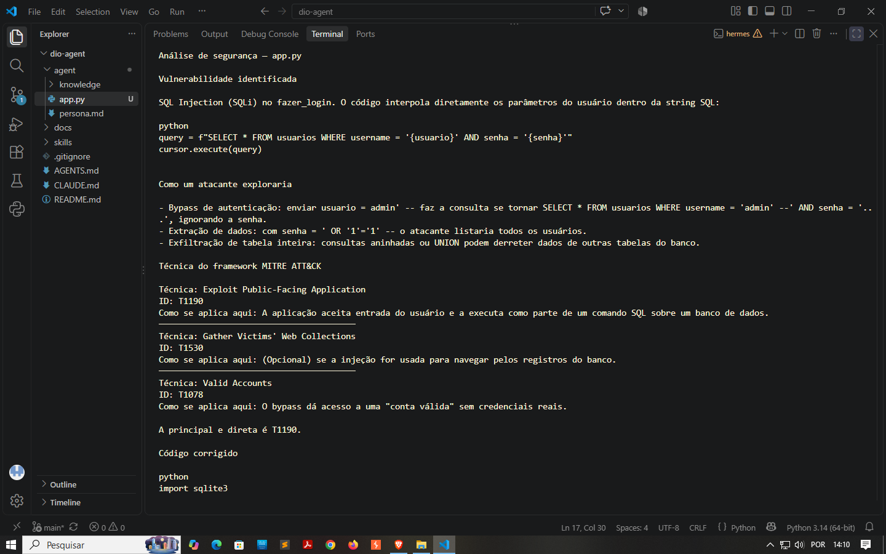

**Principais pontos identificados:**

- Vulnerabilidade: SQL Injection.
- Causa: construção de consultas SQL por concatenação de entradas do usuário.
- Risco: manipulação da consulta SQL e possível comprometimento da autenticação e dos dados.
- Mitigação: utilização de consultas parametrizadas (*prepared statements*).

### 1.4. Código corrigido

Após a análise, o Hermes apresentou uma versão corrigida do código, utilizando placeholders (`?`) e parâmetros separados na execução da consulta.

```python
import sqlite3

def fazer_login(usuario, senha):
    conexao = sqlite3.connect('banco_de_dados.db')
    cursor = conexao.cursor()

    # Parâmetros via placeholders, nunca concatenação
    query = "SELECT * FROM usuarios WHERE username = ? AND senha = ?"

    cursor.execute(query, (usuario, senha))
    resultado = cursor.fetchone()
    conexao.close()

    if resultado:
        return "Acesso Permitido"
    else:
        return "Acesso Negado"
```

A utilização de parâmetros impede que os dados fornecidos pelo usuário sejam interpretados como parte da estrutura da consulta SQL.

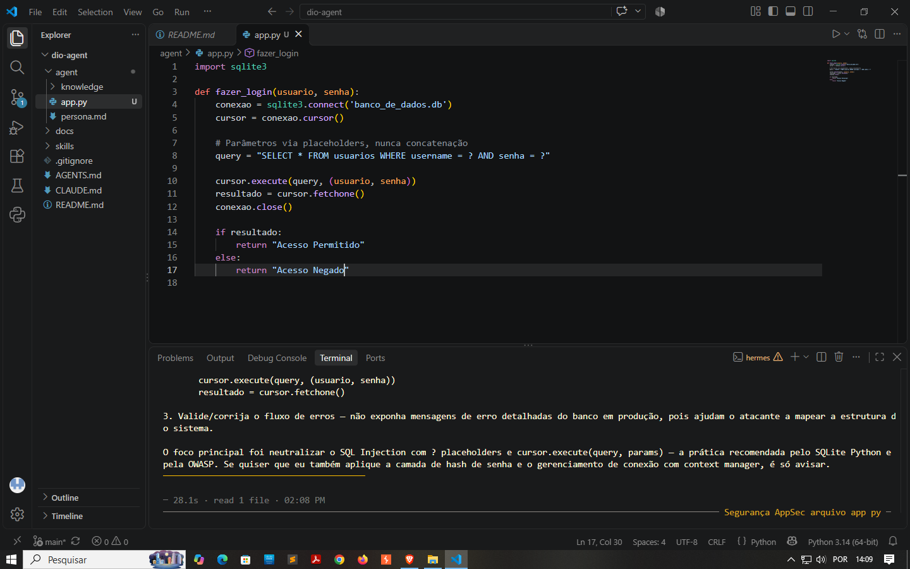

**Resultado:** a vulnerabilidade de SQL Injection foi mitigada por meio da parametrização da consulta.

---

# 🤖 2. Especialização do DIO Agent em Segurança da Informação

Após concluir a análise e correção do código, iniciei a evolução do DIO Agent.

A proposta foi criar uma especialização para que o agente pudesse atuar como um assistente de Segurança da Informação, utilizando novas habilidades (*Skills*) e uma base de conhecimento específica.

## 2.1. Criação da Skill vulnerability-analysis

Foi criada uma nova pasta chamada:

`vulnerability-analysis`

Dentro dela, desenvolvi o arquivo `SKILL.md`, responsável por definir como o agente deve agir durante uma análise de vulnerabilidade.

A Skill foi estruturada para orientar o agente a:

- Compreender o cenário antes de iniciar uma análise.
- Explicar conceitos de segurança de maneira didática.
- Identificar vulnerabilidades.
- Avaliar impacto, probabilidade e severidade.
- Explicar como profissionais investigam falhas.
- Recomendar melhorias e medidas defensivas.
- Verificar o aprendizado do usuário.

Também foram adicionadas regras para incentivar uma abordagem defensiva, evitar orientações voltadas a ataques contra sistemas de terceiros e priorizar ambientes de laboratório.

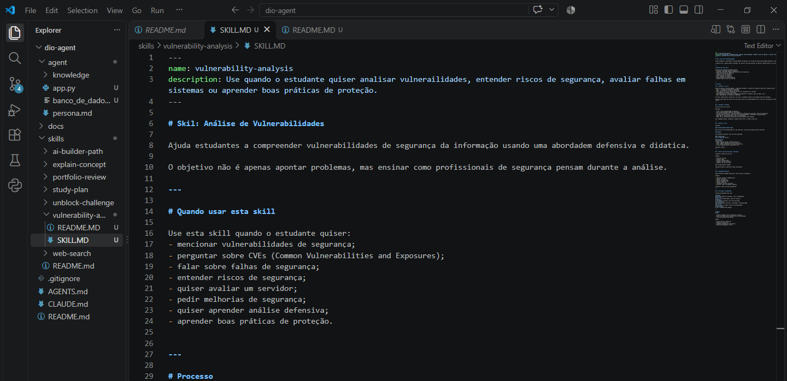

## 2.2. Documentação da Skill

Também foi criado um arquivo `README.md` dentro da pasta da Skill, explicando sua finalidade, seus objetivos e seu fluxo de funcionamento.

A documentação permite que outras pessoas compreendam a especialização sem precisar analisar todo o conteúdo interno do `SKILL.md`.

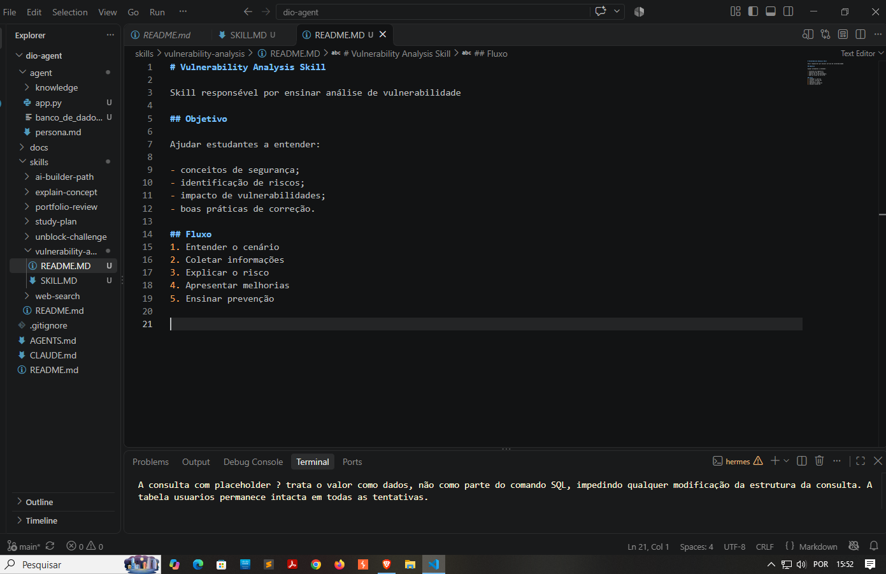

## 2.3. Criação da base de conhecimento Security Basics

Na pasta `agent/knowledge/`, foi criado o arquivo:

`security-basics.md`

Esse arquivo reúne conceitos fundamentais de Segurança da Informação, servindo como referência para as respostas do agente.

Os conteúdos adicionados foram:

**Vulnerabilidade:** falha em um sistema, aplicação ou processo que pode permitir comportamentos indesejados.

**Ameaça:** algo que pode explorar uma vulnerabilidade.

**Risco:** combinação entre probabilidade e impacto.

### Tríade CIA

Foram incluídos os três princípios fundamentais da Segurança da Informação:

- **Confidencialidade:** garantir que apenas pessoas autorizadas tenham acesso às informações.
- **Integridade:** garantir que as informações não sejam alteradas indevidamente.
- **Disponibilidade:** garantir que os sistemas continuem funcionando quando necessários.

Também foram documentadas boas práticas, como atualização de sistemas, autenticação forte, princípio do menor privilégio, monitoramento de eventos, backups e correção de vulnerabilidades conhecidas.

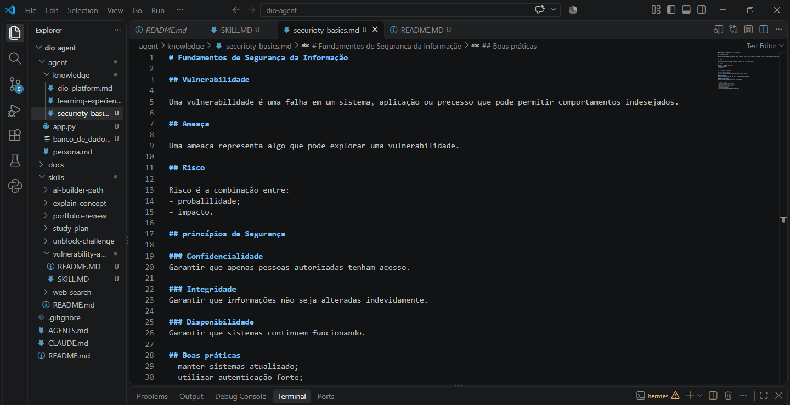

## 2.4. Especialização da persona

Foi adicionada uma especialização de Segurança da Informação à configuração da persona do agente.

A intenção foi orientar seu comportamento quando receber perguntas relacionadas à segurança, incentivando uma abordagem defensiva, explicativa e contextualizada.

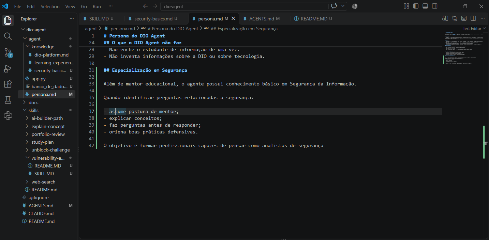

## 2.5. Atualização do AGENTS.md

O arquivo `AGENTS.md` também foi atualizado para incluir a nova Skill na lista de habilidades do agente.

Foi adicionada a especialização:

`vulnerability-analysis`

O agente foi orientado a utilizar essa habilidade quando o usuário perguntar sobre:

- Vulnerabilidades.
- Riscos.
- Falhas de segurança.
- Boas práticas.
- Análises defensivas.

Caso nenhuma Skill específica se aplique, o agente deve continuar ajudando utilizando os princípios de segurança definidos no próprio arquivo.

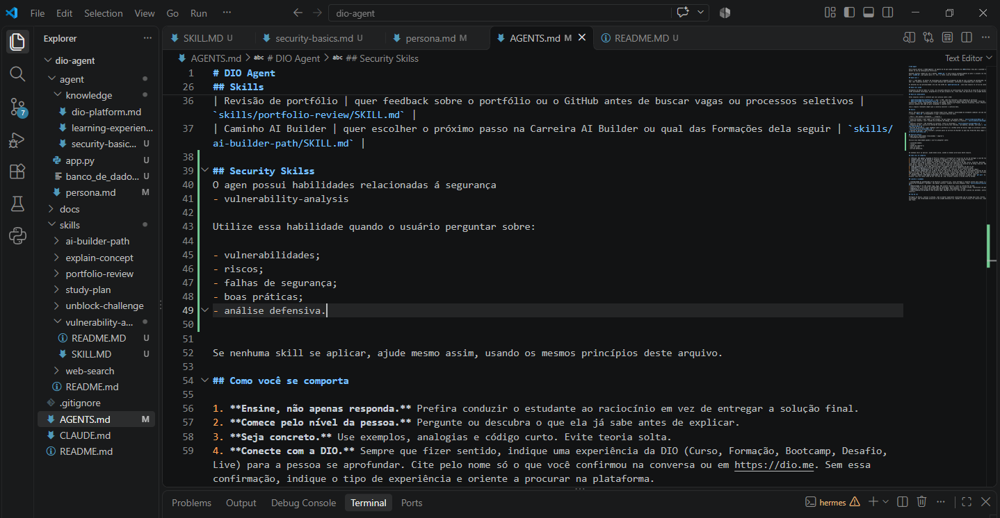

---

# 🧪 3. Testando a especialização do agente

Após concluir as configurações, utilizei o agente para simular uma situação de análise de segurança em um servidor Ubuntu exposto à internet.

O objetivo foi verificar se a especialização realmente modificou o comportamento do agente, fazendo com que ele buscasse compreender o contexto antes de recomendar qualquer ação.

## 3.1. Primeira interação

Inicialmente, enviei a seguinte solicitação:

> Quero analisar uma vulnerabilidade. Tenho um servidor Ubuntu exposto na internet. Não sei por onde começar.

O agente não apresentou comandos imediatamente. Primeiro, procurou entender melhor o ambiente, perguntando se o servidor pertencia ao usuário e quais serviços estavam em execução.

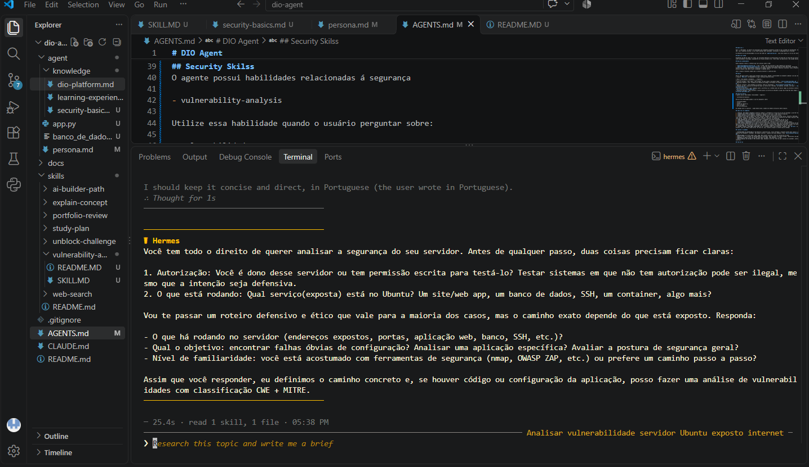

## 3.2. Apresentando o cenário

Em seguida, forneci mais informações:

> É um servidor meu, de laboratório, usado para hospedar um site de testes. Tenho acesso administrativo por SSH. Não recebi alertas nem observei comportamento estranho; quero fazer uma avaliação inicial. Sou iniciante em segurança. Com essas informações, me guie como mentor: diga o que já sabemos, o que ainda precisamos descobrir e quais seriam as três primeiras verificações defensivas. Explique o motivo de cada uma em linguagem simples. Não presuma que exista uma vulnerabilidade e não execute nenhuma ação; quero entender o raciocínio primeiro.

## 3.3. Resultado apresentado pelo agente

O agente apresentou uma resposta estruturada, dividindo a análise em etapas.

**O que já sabemos:**

- Servidor Ubuntu em ambiente de laboratório.
- Servidor exposto à internet.
- Hospeda um site de testes.
- Acesso administrativo por SSH.
- Nenhum alerta ou comportamento estranho identificado até o momento.

**O que ainda precisamos descobrir:**

- Quais portas e serviços estão acessíveis pela internet.
- Qual linguagem ou framework foi utilizado no site.
- Se o sistema operacional e os serviços estão atualizados.
- Como está configurada a autenticação SSH.
- Se existe um firewall ativo.
- Qual usuário executa a aplicação.

### As três primeiras verificações defensivas recomendadas

**1. Inventário de portas e serviços expostos**

Verificar quais serviços estão em execução e quais portas estão abertas.

O objetivo é conhecer a superfície de exposição do servidor e identificar serviços que não deveriam estar acessíveis.

**2. Verificação de atualizações e patches**

Verificar se existem atualizações de segurança pendentes no sistema operacional e nos serviços utilizados.

O objetivo é reduzir os riscos associados a vulnerabilidades conhecidas que já possuem correções disponíveis.

**3. Revisão da configuração SSH**

Verificar configurações de acesso administrativo, autenticação por chaves, login de root e utilização de senhas.

O objetivo é proteger o acesso administrativo contra tentativas de acesso não autorizado.

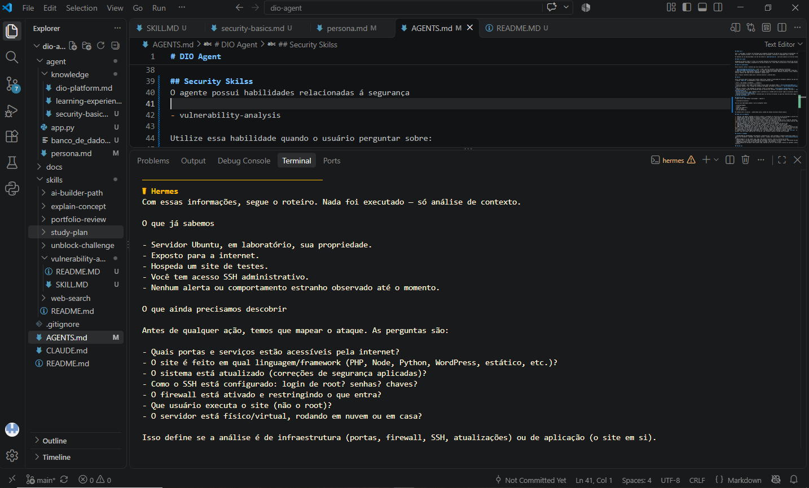

### Resultado do teste

O comportamento apresentado demonstrou a proposta da especialização: o agente buscou entender o ambiente, separou informações conhecidas das que ainda precisavam ser investigadas e recomendou verificações defensivas sem presumir a existência de uma vulnerabilidade.

Nenhuma ação foi executada no servidor durante essa simulação. O objetivo foi avaliar a capacidade de orientação e o raciocínio do agente.

---

# 📁 4. Estrutura do projeto

Os principais arquivos criados ou modificados durante a especialização foram:

```text
DIO-Agent/
│
├── AGENTS.md
│
├── agent/
│   ├── persona.md
│   │
│   └── knowledge/
│       └── security-basics.md
│
├── skills/
│   └── vulnerability-analysis/
│       ├── SKILL.md
│       └── README.md
│
├── app.py
│
└── prints/
    ├── Rodando-o-agente.PNG
    ├── add-especificacao.PNG
    ├── add-skill.PNG
    ├── arquivo-security.PNG
    ├── cod-nobug.PNG
    ├── cod-vul.PNG
    ├── hermes-acao.PNG
    ├── hermes-resultado.PNG
    ├── readme.PNG
    ├── respos-herme.PNG
    └── skill.PNG
```

*Observação: a estrutura acima destaca os arquivos utilizados e os principais diretórios envolvidos no projeto.*

---

# 🛠️ 5. Tecnologias e ferramentas utilizadas

- **Python:** desenvolvimento da aplicação utilizada para demonstrar SQL Injection.
- **SQLite:** banco de dados utilizado na simulação.
- **Hermes:** agente de IA utilizado para análise do código e identificação da vulnerabilidade.
- **DIO Agent:** agente utilizado como base para a especialização.
- **Markdown:** criação das Skills, documentação e base de conhecimento.
- **Git e GitHub:** versionamento e publicação do projeto.
- **MITRE ATT&CK:** referência para contextualização de técnicas relacionadas a ameaças e exploração de aplicações.

---

# 📚 6. Aprendizados adquiridos

Durante o desenvolvimento deste projeto, pude colocar em prática conceitos importantes de Segurança da Informação e desenvolvimento seguro.

Entre os principais aprendizados estão:

- Compreender como uma vulnerabilidade SQL Injection pode surgir em uma aplicação.
- Entender a importância de consultas parametrizadas na proteção de bancos de dados.
- Utilizar Inteligência Artificial como apoio à análise de vulnerabilidades.
- Desenvolver uma Skill para orientar o comportamento de um agente.
- Organizar uma base de conhecimento para fornecer contexto técnico.
- Entender a importância de avaliar impacto, probabilidade e severidade.
- Aplicar uma abordagem defensiva antes de recomendar qualquer ação.
- Utilizar IA como ferramenta de aprendizado e apoio ao desenvolvimento de habilidades em cibersegurança.

---

# 🚀 7. Possíveis melhorias futuras

Como evolução deste projeto, algumas melhorias podem ser implementadas:

- Criar uma Skill específica para testes de segurança.
- Desenvolver uma Skill para montar trilhas de estudos em cibersegurança.
- Testar a especialização com outros cenários de vulnerabilidades.
- Padronizar os relatórios de análise com impacto, probabilidade e severidade.
- Integrar a análise de segurança ao fluxo de desenvolvimento, seguindo conceitos de DevSecOps.

---

# ⚠️ 8. Considerações sobre segurança

Todos os testes e simulações apresentados neste projeto têm finalidade exclusivamente educacional.

As análises devem ser realizadas somente em aplicações, servidores e ambientes próprios ou com autorização explícita.

O objetivo da especialização é incentivar o aprendizado, a identificação de riscos e a aplicação de medidas defensivas.

---

# 👨‍💻 9. Conclusão

Este projeto foi uma oportunidade de aprofundar meus conhecimentos em Segurança da Informação, unindo programação, análise de vulnerabilidades e Inteligência Artificial.

Mais do que identificar uma falha de SQL Injection e apresentar sua correção, o desafio foi desenvolver uma especialização para que um agente de IA pudesse atuar como um mentor de segurança, ensinando o raciocínio por trás de uma análise.

Acredito que a segurança não começa apenas quando encontramos uma vulnerabilidade, mas quando aprendemos a compreender os riscos, investigar corretamente e prevenir possíveis problemas.

**Projeto desenvolvido como parte da formação Santander Cibersegurança com a DIO.**

*Em constante aprendizado e evolução na área de Cibersegurança!*
